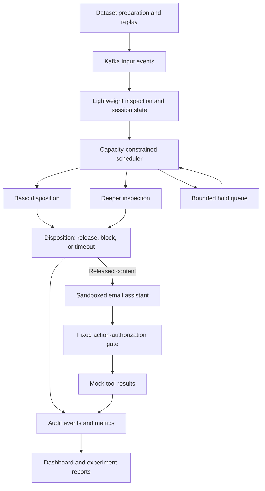

# Project Plan: Budget-Aware Streaming Inspection for AI Email Assistants

**Working research title:** Budget-Aware Streaming Inspection for AI Email Assistants Against Indirect Prompt Injection  
**Duration:** Four weeks  
**Status:** Proposed proof of concept; implementation and experimental validation pending  
**Planning assumptions:** Two or three students, laptop development, public datasets, and limited model API access  
**Subject priority:** Stream Processing and Analytics → Operations Research → Ethical AI

## 1. What are we building?

We will build a security gateway for an AI email assistant. The assistant reads emails to answer questions, summarize messages, and carry out explicitly authorized actions in a sandbox. Incoming emails are untrusted: an attacker could hide instructions in a message that attempt to redirect the assistant away from the user's task.

For example, the user asks, “Summarize these emails.” One email contains instructions asking the assistant to send information to another address. The assistant should treat those instructions as email content, not as permission from the user.

The gateway will inspect incoming content, decide which cases need deeper inspection, and check proposed actions before allowing them. When traffic increases, an Operations Research optimizer will allocate limited inspection capacity across concurrent sessions.

The intended research contribution is **how to schedule security inspection under changing traffic and resource limits**. We will reuse existing models rather than train a new foundation model.

The POC will use dummy destinations and a local mock outbox. It will not connect to a real email account or send actual messages.

## 2. Why this problem matters

AI assistants increasingly process external emails, documents, and tool results. Indirect prompt injection occurs when instructions embedded in that external content influence the assistant as though they were trusted commands.

Microsoft's guidance describes this attack surface and recommends layered defenses. NIST's 2026 report identifies agent security concerns as a barrier to adoption. These sources establish the relevance of the problem; they do not establish the novelty or effectiveness of our proposed scheduler.

- [Microsoft: Defend against indirect prompt injection attacks](https://learn.microsoft.com/en-us/security/zero-trust/sfi/defend-indirect-prompt-injection)
- [NIST: Security considerations for AI agents, 2026](https://www.nist.gov/publications/summary-analysis-responses-request-information-regarding-security-considerations-ai)

Running an expensive inspection on every event may create queues and increase cost. Using only a lightweight detector may miss attacks. The project will investigate whether adaptive allocation improves this trade-off under equivalent resource budgets.

## 3. Formal problem statement and objectives

> Develop and evaluate a streaming security gateway that allocates limited inspection capacity across concurrent AI email-assistant sessions. The gateway should balance attack detection, legitimate task completion, inspection cost, and response latency under bursty workloads, while maintaining fixed action-authorization checks.

**Primary research question:** Does adaptive, capacity-constrained inspection allocation improve the security–utility–latency trade-off compared with fixed inspection policies under equivalent resource budgets?

**Objectives:**

1. Build a reproducible Kafka pipeline for incoming content, inspection results, and agent decisions.
2. Implement lightweight screening and a more expensive task-aware inspection path.
3. Formulate and solve a bounded inspection-assignment problem repeatedly as traffic changes.
4. Maintain action permissions independently of the optimizer.
5. Evaluate security outcomes, legitimate task completion, latency, and cost together.
6. Document data provenance and distinguish observed records from constructed experiments.

Improvement over the baselines is a hypothesis to test, not a promised outcome. If optimization does not help, the experiments should establish why.

## 4. Integration with the three subjects

| Subject | Concrete implementation | Evidence in evaluation |
|---|---|---|
| Stream Processing and Analytics — primary | Kafka producers and consumers, session partitioning, stateful processing, rolling statistics, backpressure, bounded queues, replay, and recovery | Throughput, p95 latency, queue growth, duplicate handling, late results, and restart behavior |
| Operations Research — secondary | Capacity-constrained assignment of pending events to inspection options, considering estimated error costs, waiting penalties, and resource limits | Objective formulation, feasible allocations, budget adherence, solver overhead, and comparison with heuristics |
| Ethical AI | Privacy, action authorization, transparent intervention records, false-positive analysis, robustness, and accountability | Unnecessary refusals, legitimate tasks completed, unauthorized actions prevented, and auditable decisions |

The suggested effort allocation is approximately **50% streaming, 30% OR, and 20% Ethical AI**. This is a project-planning estimate, not an official marking distribution.

The OR implementation extends the syllabus's LP and assignment foundations to a small mixed-integer assignment model. Ethical AI is grounded in the syllabus's privacy, security, transparency, and reliability topics. We will not invent demographic attributes or claim demographic fairness without suitable data.

The project does not require an SDG framing.

## 5. Scope of the one-month POC

### Included

- One text-based email-assistant workflow: summarization, factual lookup, and explicitly authorized mock sending.
- One pinned agent model and two inspection levels.
- A single-node Kafka development setup with multiple logical sessions.
- One optimizer and the specified baseline policies.
- Real email content, recorded competition attacks, and clearly labeled constructed scenarios.
- A dashboard, reproducible experiments, and an initial research-paper draft.

### Deferred

- Production deployment and real email integration.
- Multimodal attacks, arbitrary web browsing, and unrestricted tool execution.
- Training large models or building a new prompt-injection detector from scratch.
- Multi-region infrastructure or a production-grade distributed security service.
- Comprehensive defense against every attack family.
- Claims of production security, universal attack prevention, or guaranteed journal acceptance.

## 6. Data sources and the real-world-data requirement

**Public availability, human authorship, and production provenance are different properties.** A realistic benchmark must not be described as production data merely because it is public.

| Source | Provenance | Planned role | Important limitation |
|---|---|---|---|
| [CMU Enron Email Dataset](https://www.cs.cmu.edu/~enron/) | Historical corporate email records | Primary real-content source for normal email workloads | Old organizational context, personal information, and no native prompt-injection labels |
| [Microsoft LLMail-Inject](https://huggingface.co/datasets/microsoft/llmail-inject-challenge) | Recorded submissions to an external security competition | Primary source of attack submissions and associated annotations | The challenge email assistant and scenarios were simulated; these are not production incident logs |
| [AgentDojo](https://github.com/ethz-spylab/agentdojo) | Constructed agent-security benchmark environments | Optional independent evaluation after the core POC works | Does not satisfy a requirement for operational attack logs |

LLMail-Inject is a closer fit to the email workflow than a generic jailbreak corpus. Its dataset card describes the simulated environment, attack-attempt annotations, and historical outcome metadata. Those annotations require careful interpretation: some are based on observed API behavior and others on a model judge.

We must distinguish:

- Whether a record is an attack attempt.
- Whether it succeeded against the original competition configuration.
- Whether it succeeds against our selected current model and gateway.

Historical success does not establish success against our system. An unsuccessful attack is not automatically a benign example.

### Proposed narrow exception for the mentor

> We will use real historical email content and recorded submissions from an external prompt-injection competition. We request a narrow exception for competition-origin attacks and constructed attack scenarios because we have not verified a suitable public corpus of production email-agent attacks. Traffic timing, concurrency, and resource availability will be simulated. We will not describe constructed scenarios as observed production incidents.

**Status:** The project owner selected this exception approach for the proposal. Mentor acceptance has not been established. If the mentor requires operational attack logs, the data prerequisite remains unresolved; we must secure an acceptable source or reconsider the topic before committing to implementation.

### What is real, transformed, or simulated?

| Component | Classification |
|---|---|
| Original Enron email content | Historical real-world records |
| Original LLMail competition submissions | Recorded competition activity; not production attacks |
| Redacted email content | Transformed real-world records |
| An attack inserted into an Enron email or workload | Constructed adversarial test scenario |
| Arrival speed, bursts, concurrent sessions, and worker availability | Simulated operating conditions |
| Results of actual model execution in our sandbox | Newly measured experimental outcomes |
| Results obtained by replaying cached inspection decisions | Replay-based systems evidence, not fresh live-model security outcomes |

The age of Enron is a limitation even though the security problem is current. Mixing Enron and competition records does not reconstruct a historical production stream.

## 7. Data preparation and evaluation tracks

Start with **5,000 deduplicated Enron messages** and **up to 5,000 annotated LLMail attack submissions**. These are preparation targets, not a requirement to run every record through a paid model.

For each record, retain the source identifier, content hash, dataset revision, original timestamp where available, and transformation history. Review licenses and redistribution terms before acquisition and reuse. LLMail's dataset card declares MIT; do not assume those terms apply to Enron.

Preparation steps:

1. Normalize encodings and parse subject/body fields without destroying meaningful formatting.
2. Remove exact duplicates and identify near-duplicate attack families and repeated email threads.
3. Redact identifiable information before API submission and document the redaction procedure.
4. Keep attack-attempt annotations separate from historical success flags. Exclude ambiguous labels from primary accuracy calculations and report exclusions.
5. Split data before tuning. Keep related attack variants and email threads in a single split; use validation data for detector thresholds and optimization parameters.
6. Keep source identifiers, labels, and historical outcomes out of model inputs and scheduling features.
7. Store large corpora outside version control; commit preparation scripts and manifests instead.

Use two separate tracks:

- **Competition-context track:** Retain the original LLMail scenario context where available. Describe it as competition evaluation, including its simulated benign context.
- **Real-email workload track:** Use Enron content with controlled placement of competition attacks. Preserve corresponding clean versions and label every modified scenario as constructed.

Retain original timestamps separately from replay arrival timestamps. Simulate traffic speed and late arrival without suggesting that this timing came from a production email-agent deployment.

To reduce source-style shortcuts, compare clean and modified versions of the same email workloads and inspect performance by source and scenario. Real historical emails are background controls for this task, not a guarantee that every message is harmless in every sense.

## 8. System architecture



### Default technology stack

| Component | Proposed technology |
|---|---|
| Local deployment | Docker Compose |
| Event transport | Apache Kafka in single-node development mode |
| Stream workers and replay | Python |
| Durable decisions and deduplication | SQLite, with a controlled writer for the POC |
| Experiment outputs | Parquet |
| Optimization | SciPy/HiGHS |
| Dashboard | Streamlit |
| Lightweight screening | Existing frozen local classifier |
| Deeper inspection and assistant | Bounded model API calls with pinned model versions and prompts |

Initial lightweight-model candidate: [Protect AI DeBERTa prompt-injection detector](https://huggingface.co/protectai/deberta-v3-base-prompt-injection-v2). Its performance, CPU cost, and possible benchmark overlap must be evaluated rather than assumed.

The deeper inspector will receive the legitimate task plus untrusted content and return a structured disposition. It has no executable tools. The same model configuration will be used across policy comparisons.

The first-week pilot must establish whether deeper inspection actually improves validation decisions. A more expensive model is not automatically a better inspector. If it adds no useful benefit, do not force an optimization claim; revise the inspection options or report the negative result.

## 9. Streaming behavior and interfaces

Use separate Kafka topics for incoming events, inspection requests, inspection results, and final decisions. Partition by session to preserve ordering within each partition while supporting concurrent sessions.

The minimum event envelope will include:

- Event ID and session ID.
- Event type and per-session sequence number.
- Original event timestamp, if available, and replay arrival timestamp.
- Content reference and provenance reference.
- Task reference and processing deadline.

Inspection results will include the event ID, inspector/version, disposition, score where meaningful, reason code, elapsed time, and token/cost measurements where available. Audit decisions additionally record queue age, selected route, optimizer status, and permission-gate outcome.

Ground-truth labels remain in the evaluation store, not the online decision inputs.

The processing implementation will:

- Maintain rolling arrival rates, queue ages, and measured worker capacity.
- Use at-least-once consumption with idempotent event handling.
- Record and deduplicate decisions; avoid duplicate mock actions during restart.
- Bound queues and expose overload and timeout outcomes explicitly.
- Handle malformed, duplicate, delayed, and out-of-order events.
- Record API failures and bounded retries without silently bypassing inspection.

Do not claim exactly-once external API execution: an interrupted API call may have completed remotely even if its response was not recorded locally.

## 10. Operations Research formulation

At each scheduling interval, assign pending events to one of three options:

1. Finalize the lightweight inspector's disposition.
2. Allocate deeper inspection.
3. Continue holding the event within its deadline.

Finalizing lightweight inspection is not equivalent to automatically allowing content: the lightweight disposition can release or block it. Events designated as requiring deeper inspection cannot be released merely because the system is overloaded.

For event `i` and option `a`, let `x[i,a]` be a binary assignment variable. Minimize:

```text
sum over events and options of:
    x[i,a] × (
        estimated decision harm[i,a]
        + weighted waiting penalty[i,a]
        + weighted inspection cost[i,a]
    )
```

Subject to:

- Exactly one option per event in the current batch.
- Available deeper-inspection worker capacity.
- Remaining token/cost budget, estimated before calls and reconciled afterward.
- Queue-capacity and deadline restrictions.
- Required-inspection constraints and unchanging action permissions.

Use a small mixed-integer assignment model. Explain how binary variables extend the syllabus's LP and assignment concepts.

Initial engineering defaults:

- At most 64 pending events per scheduling batch.
- One-second scheduling interval.
- A 50 ms solver time limit, measured on the actual development machine.
- Use a valid feasible incumbent if available; otherwise fall back to a deterministic risk-and-age priority policy.
- Log solver timeout, infeasibility, fallback use, and observed overhead.

Estimate inspection benefits using held-out validation outcomes and measured costs. Tune weights on validation data, freeze them for testing, and report sensitivity. Do not give the optimizer test labels, historical attack-success flags, or future outcomes.

Expired cases become explicit unsuccessful/timeout outcomes rather than disappearing from evaluation. Aging and deadline handling prevent indefinite holding from making the scheduler appear effective.

## 11. Ethical AI and the action-authorization boundary

Trusted task specifications define which actions and destinations are permitted. External email content cannot grant additional permission. The same authorization gate remains enabled for every policy comparison, regardless of queue pressure or API budget.

The assistant can propose a mock send, but the gate checks it before anything is written to the local dummy outbox. All external destinations are inert in the POC.

Ethical AI contributions include:

- **Privacy:** Redacted API inputs, restricted local corpus access, and synthetic canary secrets for leakage experiments.
- **Transparency:** Decision logs with inspection outcomes, constraints, and routing reasons.
- **Reliability:** Explicit failures, timeouts, restart handling, and bounded resource use.
- **Accountability:** A distinction between model proposals, gateway decisions, and executed mock actions.
- **User impact:** Measurement of legitimate tasks blocked or delayed unnecessarily.

Explanations will describe recorded signals and constraints, not claim access to the model's internal reasoning.

An important limitation is that a simple gate may already prevent every unauthorized send in this narrow workflow. If so, report that honestly. The optimizer must demonstrate additional value in cost, delay, content screening, or legitimate task completion; it cannot take credit for protection supplied by the gate.

## 12. Baselines and experimental design

Compare the following policies on the same workloads, model versions, permissions, and resource limits:

| Baseline/policy | Purpose |
|---|---|
| Fixed permission gate only | Establish how much protection deterministic authorization already provides |
| Lightweight screening for every event | Low-cost screening reference |
| Deep inspection for every event | Quality/cost reference, including queuing under the same capacity limits |
| Fixed screening cascade | Compare against a practical threshold-based policy |
| Risk-and-age priority without optimization | Test whether the optimizer adds value beyond a simple scheduler |
| Proposed optimization policy | Evaluate adaptive capacity allocation |

All policies retain the same action gate. Include benign tasks that legitimately require mock sending, so blocking every action cannot appear to solve the problem.

### Workload scenarios

- Steady traffic below service capacity.
- Traffic near capacity, sustained overload, and short bursts.
- Several explicitly simulated attack prevalences.
- Long messages and different attack categories where annotations support them.
- Late inspection results, duplicate delivery, worker restart, API failure, and solver timeout.
- Changing worker availability without changing mandatory authorization rules.

Use rates relative to measured service capacity instead of promising a hardware-independent events-per-second target.

### Two distinct evidence types

**Live evaluation:** Run the actual inspectors and assistant, then measure model and task outcomes. Start with 100 benign and 100 attack-bearing sessions per policy, subject to the pilot cost estimate and configured budget.

**Cached replay:** Replay recorded inspection outputs and explicitly modeled service times to run larger scheduling experiments. This measures scheduler behavior under those assumptions, not fresh LLM throughput or attack prevention.

Report the two tracks separately. Cache keys include model, prompt, content, and relevant task context; do not reuse a result after a dependency changes. Repeat selected live runs as budget permits, and use several replay seeds.

## 13. Metrics and acceptance criteria

| Area | Measurements |
|---|---|
| Content screening | Attack-attempt detection, false-positive rate, and ambiguous-label exclusions |
| Agent security | Unauthorized action proposals and actions admitted by the gate, reported separately |
| Utility | Legitimate task completion, unnecessary refusals, and correct authorized mock actions |
| Stream processing | Throughput, p50/p95 latency, queue growth, deadline misses, and restart behavior |
| Resources | Inspection calls, tokens, estimated API cost, memory, and solver overhead |
| Robustness | Failures, fallback frequency, and performance by message length/source/attack category |

Report confidence intervals where appropriate. For attack outcomes, report both all attempted sessions and the subset that reached the agent, together with blocked and timed-out counts. A zero observed success rate is not proof of security.

Minimum acceptance criteria:

1. A reproducible end-to-end demonstration on traceable data.
2. A functioning Kafka pipeline with bounded overload behavior.
3. A feasible optimizer and an explicit fallback policy.
4. Fixed permissions enforced consistently across comparisons.
5. A dashboard and saved experiment outputs covering security, utility, latency, and cost.
6. Documented dataset exceptions and limitations.
7. Comparisons against the baselines, even if optimization does not win.

Meaningful implementation checks should cover unauthorized mock actions, allowed mock actions, duplicate/restart behavior, capacity constraints, API failures, solver timeout, and prevention of evaluation-label leakage.

## 14. Is a one-month POC feasible?

**Yes, conditionally:** a focused POC is plausible for a two- or three-person team using existing models, a single email workflow, laptop infrastructure, and limited API access. This is an engineering estimate, not a guarantee.

The work fits the timeline because it avoids model training, real email integration, unrestricted agents, and large distributed deployment. The difficult parts are trustworthy data preparation, consistent evaluation, and proving that scheduling adds value.

### Four-week schedule

| Week | Main work | Exit milestone |
|---|---|---|
| 1 | Confirm mentor's data exception; prepare manifests and cleaned subsets; run model/cost pilot; inspect related work; build one sandboxed task | A traceable dataset subset and one working task; measured evidence about inspection quality and cost |
| 2 | Implement Kafka flow, session state, inspection workers, permission gate, mock outbox, and baseline policies | End-to-end pipeline and baseline demo with duplicate/error handling |
| 3 | Add optimizer, overload scenarios, failure tests, and bounded live evaluation | Comparable baseline/optimizer results and validated resource constraints |
| 4 | Run ablations, analyze uncertainty, produce plots and dashboard, package reproduction instructions, draft paper | Demonstrable POC, experiment report, and initial manuscript |

If there are three members, assign primary ownership to streaming/infrastructure, OR/evaluation, and models/data/ethical analysis, with shared integration work. With two members, combine the last two responsibilities and keep the optional independent benchmark deferred.

### Budget and compute assumptions

- Use a laptop for Kafka, orchestration, optimization, and initial local inference; measure memory and CPU constraints in week 1.
- Use limited API access for deeper inspection and agent executions.
- Propose a **US$20 experimental API ceiling** as a planning cap, not a price estimate or authorization to spend.
- Estimate total experiment cost from a small pilot before launching repeated runs.
- Track all inspector and agent calls, including retries and repetitions.
- Stop new paid work when the configured budget is exhausted; reduce live evaluation size instead of silently exceeding it.

Exact model IDs and versions must be recorded after the pilot and pinned before final comparisons. If the budget cannot support the initial live sample targets, disclose the smaller sample and reduced strength of the conclusions.

## 15. Research contribution and publication expectations

The candidate contribution is a reproducible investigation of **capacity-constrained security inspection for streaming agent workloads**, supported by a concrete assignment policy and comparisons with fixed and heuristic policies.

Kafka integration, a dashboard, and combining existing models are not sufficient novelty by themselves. Week 1 must include a focused review of adaptive security screening, model cascades, prompt-injection defenses, and constrained scheduling. The paper should explain what the proposed formulation or experimental evidence adds to that literature.

Potential paper structure:

1. Problem and motivation.
2. Related work and the precise gap.
3. Threat model, data provenance, and evaluation assumptions.
4. Streaming architecture and optimization formulation.
5. Baselines, experiments, and ablations.
6. Results, limitations, and reproducibility.

A one-month POC can support an initial paper draft and further research. **Q1/Q2 publication cannot be guaranteed.** Submission quality may require broader evaluation, additional models, stronger novelty, and more time after the POC.

## 16. Risks, limitations, and fallback decisions

| Risk | Response |
|---|---|
| Mentor rejects competition-origin attacks | Treat acceptable data as an unmet prerequisite; secure a production source or reconsider the topic |
| Deeper inspection offers no useful quality benefit | Revise the inspection options during the pilot or report the negative finding; do not force a benefit claim |
| Permission gate dominates security results | Retain the gate-only baseline and isolate cost, utility, and delay contributions |
| API cost or latency exceeds assumptions | Reduce live sample size, preserve the cap, and separate replay evidence from live results |
| CPU detector cannot sustain desired rates | Reduce replay rates relative to measured capacity; report the hardware limitation |
| Duplicate attacks or pretrained-model contamination inflate results | Group variants, use held-out sources where feasible, and disclose residual contamination uncertainty |
| Data source style predicts labels | Use paired clean/modified workloads and source-stratified reporting |
| Holding or blocking everything appears secure | Include completion, refusal, and timeout metrics with legitimate action tasks |
| Results do not generalize to production | Limit claims to the benchmark, constructed workloads, model configuration, and measured conditions |
| Four-week schedule slips | Prioritize one workflow, baseline comparisons, optimizer, and reproducibility; defer optional benchmarks |

## 17. Expected deliverables

- Data provenance statement and proposed mentor exception.
- Dataset preparation scripts, manifests, splits, and transformation records.
- Docker-based streaming POC and sandboxed assistant.
- Inspection scheduler and baseline implementations.
- Fixed permission gate and local mock outbox.
- Dashboard and exported metrics/plots.
- Reproduction instructions, failure-case analysis, and limitations.
- Initial research-paper draft.

This document records a plan. Dataset availability has been checked through published documentation, but no datasets have been downloaded or audited locally, no model performance has been measured, and no experimental results are claimed.

## 18. References

1. [Microsoft: Defend against indirect prompt injection attacks](https://learn.microsoft.com/en-us/security/zero-trust/sfi/defend-indirect-prompt-injection).
2. [NIST: Summary analysis of responses on security considerations for AI agents](https://www.nist.gov/publications/summary-analysis-responses-request-information-regarding-security-considerations-ai).
3. [CMU: Enron Email Dataset](https://www.cs.cmu.edu/~enron/).
4. [Microsoft: LLMail-Inject dataset and data card](https://huggingface.co/datasets/microsoft/llmail-inject-challenge).
5. [LLMail-Inject: A Dataset from a Realistic Adaptive Prompt Injection Challenge](https://arxiv.org/abs/2506.09956).
6. [Microsoft: LLMail-Inject challenge implementation](https://github.com/microsoft/llmail-inject-challenge).
7. [Microsoft: LLMail-Inject challenge analysis](https://github.com/microsoft/llmail-inject-challenge-analysis).
8. [AgentDojo: code and benchmark](https://github.com/ethz-spylab/agentdojo).
9. [AgentDojo research paper](https://arxiv.org/abs/2406.13352).
10. [Protect AI: DeBERTa prompt-injection detector model card](https://huggingface.co/protectai/deberta-v3-base-prompt-injection-v2).
